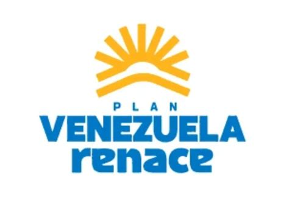
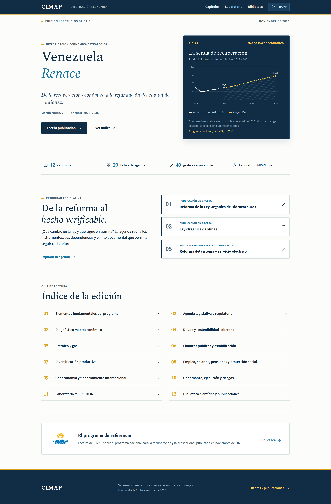
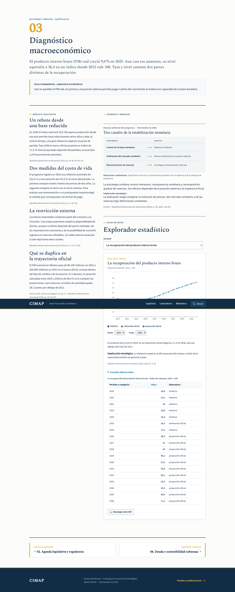
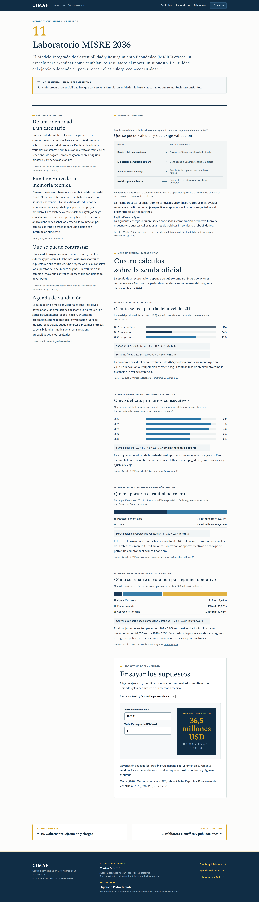
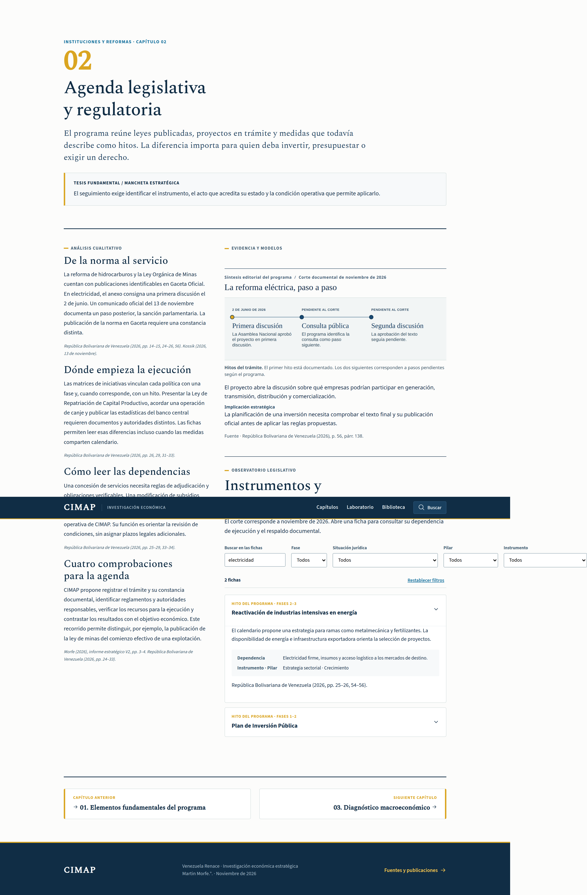
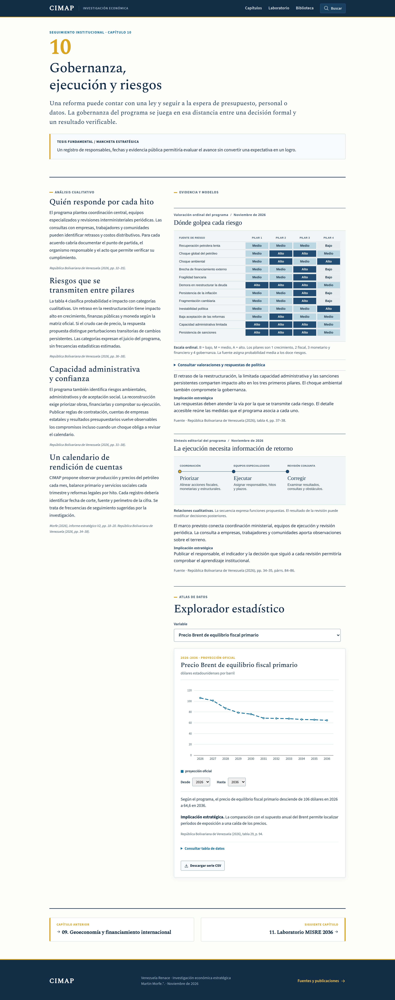
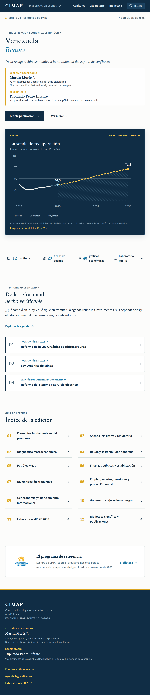
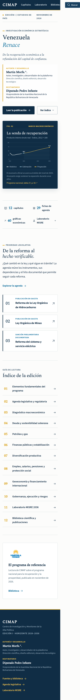
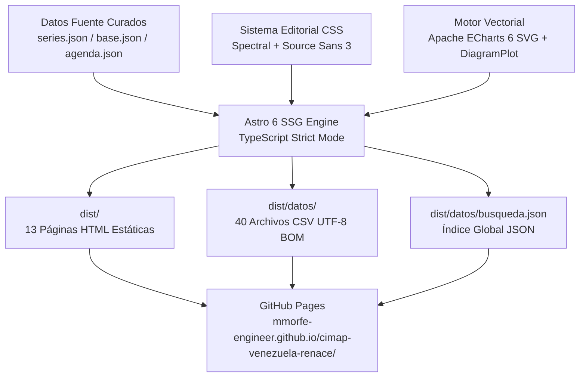
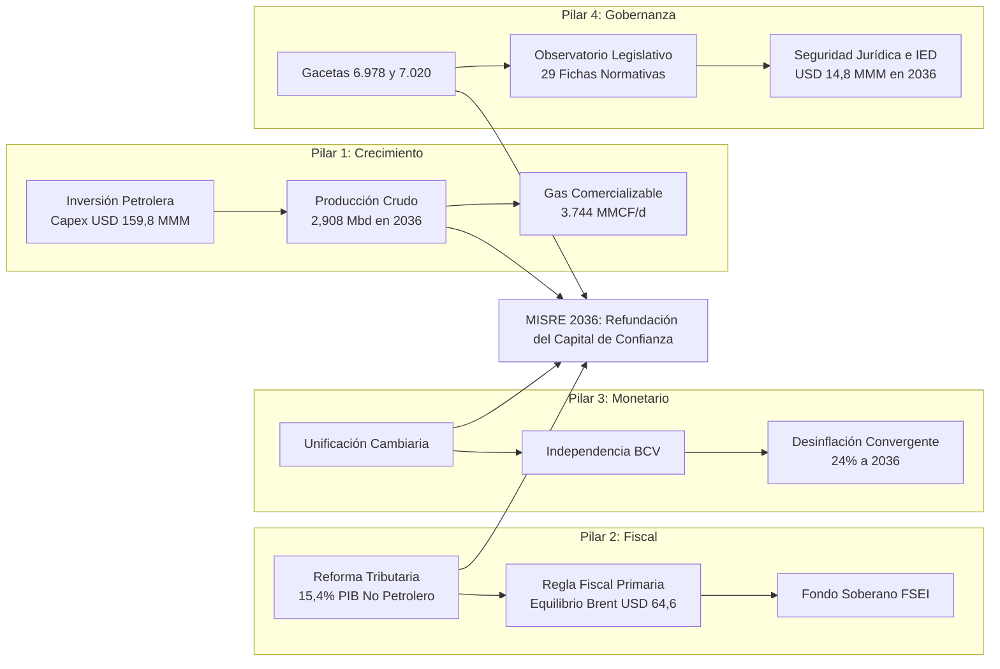

<div align="center">



# CIMAP | VENEZUELA RENACE (2026–2036)

### *Plataforma de Investigación Económica Estratégica, Modelización Macroeconométrica y Observatorio Legislativo*

[](https://astro.build/)
[](https://www.typescriptlang.org/)
[](https://echarts.apache.org/)
[](https://playwright.dev/)
[](https://github.com/mmorfe-engineer/cimap-venezuela-renace)
[](https://mmorfe-engineer.github.io/cimap-venezuela-renace/)
[](https://github.com/mmorfe-engineer/cimap-venezuela-renace)

---

### **CRÉDITOS Y DEDICATORIA INSTITUCIONAL**

**AUTORÍA, INVESTIGACIÓN Y DESARROLLO TECNOLÓGICO**  
**Martin Morfe.°.**  
*Autor, investigador y desarrollador de la plataforma*  
*Dirección científica, diseño editorial y desarrollo tecnológico*  
**Centro de Investigaciones Macroeconómicas y Políticas Públicas (CIMAP)**  

**DESTINATARIO INSTITUCIONAL**  
**Diputado Pedro Infante**  
*Vicepresidente de la Asamblea Nacional de la República Bolivariana de Venezuela*  

**URL DE PRODUCCIÓN (GitHub Pages):**  
🔗 **[https://mmorfe-engineer.github.io/cimap-venezuela-renace/](https://mmorfe-engineer.github.io/cimap-venezuela-renace/)**

</div>

---

## 📑 Tabla de Contenido

- [1. Visión y Resumen Ejecutivo](#1-visión-y-resumen-ejecutivo)
- [2. Galería Visual y Evidencia de Auditoría](#2-galería-visual-y-evidencia-de-auditoría)
- [3. Arquitectura Tecnológica del Sistema](#3-arquitectura-tecnológica-del-sistema)
- [4. Directorio de Capítulos (12 Entregas)](#4-directorio-de-capítulos-12-entregas)
- [5. Base Empírica y Catálogo de Series (40 Series Estadísticas)](#5-base-empírica-y-catálogo-de-series-40-series-estadísticas)
- [6. Observatorio de la Agenda Legislativa (29 Instrumentos)](#6-observatorio-de-la-agenda-legislativa-29-instrumentos)
- [7. Modelo MISRE 2036 y Laboratorio de Sensibilidad](#7-modelo-misre-2036-y-laboratorio-de-sensibilidad)
- [8. Diagramas de Arquitectura y Transmisión Macroeconómica](#8-diagramas-de-arquitectura-y-transmisión-macroeconómica)
- [9. Ciclo de Calidad, Pruebas y Auditoría Científica](#9-ciclo-de-calidad-pruebas-y-auditoría-científica)
- [10. Reproducción Local y Flujo CI/CD](#10-reproducción-local-y-flujo-cicd)
- [11. Delimitación Metodológica y Referencias APA](#11-delimitación-metodológica-y-referencias-apa)
- [12. Licencia y Atribución](#12-licencia-y-atribución)

---

## 1. Visión y Resumen Ejecutivo

*CIMAP | Venezuela Renace* es una plataforma digital de investigación económica estratégica de estándar internacional, diseñada conforme a los cánones analíticos de publicaciones de referencia mundial como el **World Economic Outlook del FMI**, el **Banco de Pagos Internacionales (BIS)**, **Our World in Data** y la sección de periodismo visual de **Financial Times**.

La plataforma procesa y analiza el programa nacional decenal de estabilización (Horizonte 2026–2036) bajo una arquitectura estructurada en torno a:
1. **Ratio Editorial 60/40:** 60% de visualizaciones y herramientas interactivas de datos frente al 40% de narrativa analítica y fundamentación cualitativa.
2. **Soberanía y Trazabilidad Absoluta:** 40 series temporales (496 observaciones) con trazabilidad 1:1 a los cuadros oficiales de *República Bolivariana de Venezuela (2026)* y descarga estática en CSV UTF-8 BOM.
3. **Rigor Jurídico:** Clasificación nítida de 29 instrumentos normativos entre leyes formalmente promulgadas en Gaceta Oficial, sanciones parlamentarias e hitos de planificación.
4. **Laboratorio de Sensibilidad MISRE 2036:** Módulo determinista transparente que reproduce con exactitud las identidades contables de la *Memoria Técnica*.
5. **Cero Dependencias Externas en Runtime:** Tipografía empaquetada en local, renderizado SVG nativo y cero llamadas a APIs o CDNs comerciales externas.

---

## 2. Galería Visual y Evidencia de Auditoría

A continuación se exhibe la evidencia de la auditoría visual automatizada generada con Playwright sobre Chromium en resoluciones Desktop (1440x900), Tablet (768x1024) y Mobile (375x812):

| Portada Principal (Desktop 1440x900) | Buscador Global Modal en Vivo |
| :---: | :---: |
|  |  |
| *Diseño sobrio con gráfico SVG de transición y doble columna.* | *Búsqueda instantánea indexada por teclado o botón.* |

| Visualización Interactiva ECharts SVG | Laboratorio de Sensibilidad MISRE 2036 |
| :---: | :---: |
|  |  |
| *Renderizado vectorial con filtros de período y tablas ordenables.* | *Cálculo interactivo de ratios de deuda, venta y márgenes fiscales.* |

| Agenda Legislativa Filtrable (Cap. 2) | Matriz Institucional de Riesgos (Cap. 10) |
| :---: | :---: |
|  |  |
| *Fichas desplegables con Gaceta Oficial y dependencias.* | *Matriz ordinal interactiva de probabilidad e impacto.* |

| Vista Responsiva en Tablet (iPad 768x1024) | Vista Responsiva en Smartphone (375x812) |
| :---: | :---: |
|  |  |
| *Adaptación fluida de retícula a tablet vertical.* | *Navegación compacta y táctil optimizada para móviles.* |

---

## 3. Arquitectura Tecnológica del Sistema



- **Framework:** [Astro 6](https://astro.build/) en modo completamente estático (`output: 'static'`).
- **Tipografía Local:** `@fontsource/spectral` (serifa editorial clásica) y `@fontsource/source-sans-3` (grotesca técnica de legibilidad numérica).
- **Gráficos y Visualización:** [Apache ECharts 6](https://echarts.apache.org/) en modo SVG Renderer y componentes SVG nativos (`DiagramPlot.astro`).
- **Control de Calidad:** Node.js Test Runner nativo (`node:test`) + [Playwright](https://playwright.dev/) sobre Chromium headless.
- **Despliegue Continuo:** GitHub Actions Workflow oficial en `.github/workflows/deploy.yml`.

---

## 4. Directorio de Capítulos (12 Entregas)

| N.º | Slug | Título del Capítulo | Enfoque Metodológico y Visual |
| :---: | :--- | :--- | :--- |
| **01** | `fundamentos` | **Elementos fundamentales del programa** | Cuatro pilares de rescate, calendario relativo de tres fases y principios de gobernanza. |
| **02** | `agenda-legislativa` | **Agenda legislativa y regulatoria** | 29 fichas normativas con estatus legal, Gaceta Oficial, plazos y dependencias operativas. |
| **03** | `diagnostico-macroeconomico` | **Diagnóstico macroeconómico** | Trayectoria del PIB real, contracción histórica, PIB per cápita e inflación interanual. |
| **04** | `deuda-soberana` | **Deuda y sostenibilidad soberana** | Estructura de pasivos externos al cierre de 2025: acreencias, emisores, eurobonos y multilaterales. |
| **05** | `petroleo-y-gas` | **Petróleo y gas** | Metas de producción de crudo, gas comercializable, capacidad de refinación y capex de PDVSA. |
| **06** | `finanzas-publicas` | **Finanzas públicas y estabilización** | Operaciones del sector público no financiero (% PIB y miles de millones USD eq.). |
| **07** | `diversificacion-productiva` | **Diversificación productiva** | Minería de oro documentada, manufactura privada, telecomunicaciones y composición sectorial. |
| **08** | `empleo-y-proteccion-social` | **Empleo, salarios, pensiones y protección social** | Empleo formal, cobertura educativa ENCOVI, remuneraciones públicas, pensiones y esperanza de vida. |
| **09** | `financiamiento-internacional` | **Geoeconomía y financiamiento internacional** | Balanza de pagos, exportaciones de bienes, IED neta, reservas internacionales y cuenta corriente ajustada. |
| **10** | `gobernanza-y-riesgos` | **Gobernanza, ejecución y riesgos** | Matriz ordinal de riesgos estratégicos, precio Brent supuesto vs. equilibrio fiscal primario. |
| **11** | `laboratorio-misre` | **Laboratorio MISRE 2036** | Laboratorio interactivo de sensibilidad para ensayar los supuestos aritméticos de la memoria técnica. |
| **12** | `biblioteca` | **Biblioteca científica y publicaciones** | Documentación de fuentes primarias, delimitación de alcance, conciliación estadística y citas APA 7. |

---

## 5. Base Empírica y Catálogo de Series (40 Series Estadísticas)

Todas las series cuentan con descarga directa en formato CSV estático con cabecera y metadatos:

| ID de Serie | Nombre Editorial | Período | Unidad | Fuente Original | Enlace CSV |
| :--- | :--- | :---: | :--- | :--- | :---: |
| `pib-real` | Recuperación del PIB | 2019–2036 | Índice 2012=100 | Tabla 27, p. 92 | [CSV](dist/datos/pib-real.csv) |
| `crecimiento-real` | Crecimiento real anual | 2019–2036 | % real anual | Tabla 27, p. 92 | [CSV](dist/datos/crecimiento-real.csv) |
| `pib-no-petrolero` | PIB no hidrocarburos | 2019–2036 | Índice 2012=100 | Tabla 27, p. 92 | [CSV](dist/datos/pib-no-petrolero.csv) |
| `pib-por-habitante` | PIB por habitante | 2019–2036 | USD corrientes | Tabla 27, p. 92 | [CSV](dist/datos/pib-por-habitante.csv) |
| `pib-nominal` | PIB nominal | 2019–2036 | USD MMM | Tabla 27, p. 92 | [CSV](dist/datos/pib-nominal.csv) |
| `inflacion-cierre` | Inflación fin de período | 2025–2036 | % fin de año | Tablas 24 y 27 | [CSV](dist/datos/inflacion-cierre.csv) |
| `inflacion-interanual`| Inflación últimos 12 meses | 2025–2026 | % mensual YoY | Tabla 25, p. 81 | [CSV](dist/datos/inflacion-interanual.csv) |
| `deuda-tipo` | Deuda por acreencia | Cierre 2025 | USD millones | Tabla 3, p. 20 | [CSV](dist/datos/deuda-tipo.csv) |
| `deuda-emisor` | Deuda por deudor | Cierre 2025 | USD millones | Tabla 3, p. 20 | [CSV](dist/datos/deuda-emisor.csv) |
| `eurobonos` | Principal e intereses eurobonos | Cierre 2025 | USD millones | Tabla 3, p. 20 | [CSV](dist/datos/eurobonos.csv) |
| `deuda-multilateral` | Deuda multilateral | Cierre 2025 | USD millones | Tabla 14, p. 64 | [CSV](dist/datos/deuda-multilateral.csv) |
| `produccion-crudo` | Producción de crudo | 2019–2036 | kbbl/d | Tabla 27, p. 92 | [CSV](dist/datos/produccion-crudo.csv) |
| `gas-comercializable` | Gas comercializable | 2019–2036 | MMCF/d | Tabla 27, p. 92 | [CSV](dist/datos/gas-comercializable.csv) |
| `gas-interno` | Gas mercado interno | 2026–2036 | MMCF/d | Tabla 32, p. 97 | [CSV](dist/datos/gas-interno.csv) |
| `cesta-venezolana` | Precio cesta venezolana | 2019–2036 | USD/barril | Tabla 27, p. 92 | [CSV](dist/datos/cesta-venezolana.csv) |
| `refinados` | Productos refinados | 2026–2036 | kbbl/d | Tabla 32, p. 97 | [CSV](dist/datos/refinados.csv) |
| `inversion-petrolera` | Capex sector petrolero | 2026–2036 | USD MMM | Tabla 32, p. 97 | [CSV](dist/datos/inversion-petrolera.csv) |
| `crudo-contratos` | Crudo bajo contratos CPP | 2026–2036 | kbbl/d | Tabla 32, p. 97 | [CSV](dist/datos/crudo-contratos.csv) |
| `saldo-publico` | Saldo primario SPNF | 2021–2036 | % del PIB | Tabla 29, p. 94 | [CSV](dist/datos/saldo-publico.csv) |
| `saldo-central` | Saldo primario Gobierno Central | 2021–2036 | % del PIB | Tabla 29, p. 94 | [CSV](dist/datos/saldo-central.csv) |
| `ingreso-no-petrolero`| Ingresos no petroleros | 2021–2036 | % del PIB | Tabla 29, p. 94 | [CSV](dist/datos/ingreso-no-petrolero.csv) |
| `inversion-publica` | Inversión pública | 2021–2036 | % del PIB | Tabla 29, p. 94 | [CSV](dist/datos/inversion-publica.csv) |
| `saldo-publico-dolares`| Saldo público en divisas | 2021–2036 | USD MMM eq. | Tabla 28, p. 93 | [CSV](dist/datos/saldo-publico-dolares.csv) |
| `minas-oro` | Minas de oro documentadas | Cierre 2025 | N.º de minas | Párr. 127, p. 54 | [CSV](dist/datos/minas-oro.csv) |
| `manufactura-privada`| Manufactura privada | III Trim. 2026 | % producción | Tabla 9, p. 55 | [CSV](dist/datos/manufactura-privada.csv) |
| `cobertura-movil` | Cobertura de red móvil | 2017 y 2025 | % población | Párr. 142, p. 57 | [CSV](dist/datos/cobertura-movil.csv) |
| `peso-sectorial` | Peso sectorial en el PIB | I Trim. 2026 | % del PIB aprox. | Párrs. 130 y 140–143 | [CSV](dist/datos/peso-sectorial.csv) |
| `empleo-formal` | Empleo formal | 2012, 16, 23 | % empleo total | Párr. 102, pp. 41–42 | [CSV](dist/datos/empleo-formal.csv) |
| `cobertura-educativa`| Cobertura educativa | 2014–2025 | % pob. 3-24 años | Fig. 3, p. 41 (ENCOVI) | [CSV](dist/datos/cobertura-educativa.csv) |
| `remuneraciones` | Sueldos y salarios públicos | 2021–2036 | % del PIB | Tabla 29, p. 94 | [CSV](dist/datos/remuneraciones.csv) |
| `pensiones` | Gasto en pensiones | 2021–2036 | % del PIB | Tabla 29, p. 94 | [CSV](dist/datos/pensiones.csv) |
| `esperanza-vida` | Esperanza de vida | 2012–2024 | Años | Tabla 5, p. 41 | [CSV](dist/datos/esperanza-vida.csv) |
| `inversion-extranjera`| IED neta | 2019–2036 | USD MMM | Tabla 30, p. 95 | [CSV](dist/datos/inversion-extranjera.csv) |
| `exportaciones` | Exportaciones de bienes | 2019–2036 | USD MMM | Tabla 30, p. 95 | [CSV](dist/datos/exportaciones.csv) |
| `saldo-comercial-no-petrolero`| Balanza comercial sin crudo | 2019–2036 | USD MMM | Tabla 30, p. 95 | [CSV](dist/datos/saldo-comercial-no-petrolero.csv) |
| `reservas` | Reservas brutas | 2016–jul 2026 | USD millones | Tabla 23 y párr. 233 | [CSV](dist/datos/reservas.csv) |
| `cuenta-corriente-ajustada`| Cuenta corriente ajustada | 2026–2036 | % del PIB | Tabla 31, p. 96 | [CSV](dist/datos/cuenta-corriente-ajustada.csv) |
| `brent-equilibrio` | Brent de equilibrio primario | 2026–2036 | USD/barril | Tabla 29, p. 94 | [CSV](dist/datos/brent-equilibrio.csv) |
| `brent` | Precio Brent supuesto | 2026–2036 | USD/barril | Tabla 32, p. 97 | [CSV](dist/datos/brent.csv) |
| `brecha-brent` | Margen Brent vs. equilibrio | 2026–2036 | USD/barril | Tablas 29 y 32 | [CSV](dist/datos/brecha-brent.csv) |

---

## 6. Observatorio de la Agenda Legislativa (29 Instrumentos)

El Observatorio clasifica con rigor técnico y documental cada iniciativa:

- **Leyes Promulgadas en Gaceta Oficial (2):**
  1. *Reforma de la Ley Orgánica de Hidrocarburos* (Gaceta Oficial Extraordinario n.º 6.978, 29 de enero de 2026).
  2. *Ley Orgánica de Minas* (Gaceta Oficial Extraordinario n.º 7.020, 16 de abril de 2026).
- **Sanción Parlamentaria Documentada (1):**
  3. *Reforma del Sistema y Servicio Eléctrico* (Sancionada por la Asamblea Nacional el 13 de noviembre de 2026; pendiente de publicación en Gaceta).
- **Antecedente Administrativo Formal (1):**
  4. *Facturación Digital Certificada* (Providencia del SENIAT documentada).
- **Hitos y Propuestas Programáticas (25):**
  5 al 29. Ley de Reforma Tributaria, Ley de la Función Pública, Ley de Gasto Público, Fondo Soberano de Riqueza, Ley de Formalización, Unificación Cambiaria, etc., categorizadas por fase de ejecución (Fase 1: 0–12 meses; Fase 2: 1–3 años; Fase 3: más de 3 años).

---

## 7. Modelo MISRE 2036 y Laboratorio de Sensibilidad

El **Modelo Integrado de Sostenibilidad y Resurgimiento Económico (MISRE 2036)** implementa un laboratorio de sensibilidad aritmética determinista en el cliente (`src/components/Lab.astro` y `src/lib/math.mjs`), que reproduce los tres cálculos de la *Memoria Técnica*:

1. **Relación Estática de Pasivos a Saldo Fijo / PIB Nominal:**
   $$\text{Ratio}_t = \frac{\text{Deuda}_{2025} (\text{USD 237.544 MMM})}{\text{PIB Nominal}_t} \times 100$$
   *Demostración:* En 2025 toca **242,14%**; en 2031 desciende a **118,24%**; y en 2036 alcanza **81,74%**.
2. **Escala de Sensibilidad de Facturación Petrolera Bruta:**
   $$\Delta \text{Facturación} = \text{Volumen (b/d)} \times 365 \times \Delta \text{Precio (USD/bbl)}$$
   *Demostración:* 100.000 b/d vendidos a variación de 1 USD/barril generan exactamente **USD 36,5 millones/año**.
3. **Margen Brent Previsto vs. Umbral de Equilibrio Fiscal Primario:**
   $$\text{Margen}_t = \text{Brent Supuesto}_t - \text{Brent Equilibrio Fiscal}_t$$
   *Demostración:* Inicia en **-6,9 USD/bbl** (2026) con déficit acumulado de USD 19,2 MMM hasta 2030, y alcanza superávit de **+4,2 USD/bbl** (2036).

---

## 8. Diagramas de Arquitectura y Transmisión Macroeconómica



---

## 9. Ciclo de Calidad, Pruebas y Auditoría Científica

La plataforma se somete a un estricto protocolo de integración y calidad automatizado:

```bash
# 1. Ejecutar las 14 pruebas unitarias de integridad de series, diagramas y agenda
npm test

# 2. Comprobar tipado estricto Astro y TypeScript (0 errores, 0 advertencias, 0 hints)
npx astro check

# 3. Compilar estáticamente el sitio (dist/)
npm run build

# 4. Auditoría visual en navegador real (Chromium headless vía Playwright)
npm run qa
```

**Resultado de Auditoría:**  
- Tests Unitarios: **14/14 PASS (100%)**  
- Tipado TypeScript: **0 errores, 0 advertencias, 0 hints**  
- Compilación SSG: **13 páginas HTML + 40 CSVs + 1 JSON en 4,2 s**  
- Errores de Consola en Navegador: **0 errores detectados (`console.error` = 0, 404 = 0)**  

---

## 10. Reproducción Local y Flujo CI/CD

### Instalación y Ejecución en Desarrollo

```bash
# Clonar el repositorio
git clone https://github.com/mmorfe-engineer/cimap-venezuela-renace.git
cd cimap-venezuela-renace

# Instalar dependencias
npm install

# Iniciar servidor local de desarrollo
npm run dev
# Abrir en el navegador: http://localhost:4321/cimap-venezuela-renace/
```

### Despliegue Automatizado a GitHub Pages

El archivo `.github/workflows/deploy.yml` compila y publica automáticamente la plataforma en GitHub Pages cada vez que se autoriza un push a la rama `main`:
1. Checkout y configuración de Node.js 22.
2. Ejecución obligatoria de `npm test`.
3. Compilación estática con `npm run build`.
4. Carga y despliegue del artefacto `dist/` en el entorno oficial de GitHub Pages.

---

## 11. Delimitación Metodológica y Referencias APA

Conforme a las directrices del *Documento III (Renuncias Científicas)*:
- Los datos publicados conservan el corte y perímetro de sus fuentes oficiales.
- Las proyecciones 2026–2036 son metas y escenarios del programa gubernamental, no resultados observados.
- El modelo BVAR y las simulaciones Monte Carlo continúan abiertas como líneas futuras de investigación técnica ante la disponibilidad de series trimestrales reconciliadas de alta frecuencia.

El corpus bibliográfico cumple con la norma **APA 7.ª edición** e incluye:
- *República Bolivariana de Venezuela. (2026). Venezuela Renace: Programa nacional para la recuperación y la prosperidad.*
- *Morfe, M. (2026). Venezuela Renace: De la recuperación económica a la refundación del capital de confianza (Doc. I).*
- *CIMAP. (2026). MISRE 2036: Base científica (Doc. II).*
- *CIMAP. (2026). Los límites del conocimiento: Renuncias científicas (Doc. III).*
- *Giannone, D., Lenza, M., & Primiceri, G. E. (2015). Prior selection for vector autoregressions. Review of Economics and Statistics.*
- *International Monetary Fund. (2022). Staff guidance note on the sovereign risk and debt sustainability framework.*

---

## 12. Licencia y Atribución

**Autor, Investigador y Desarrollador:** Martin Morfe.°.  
**Institución:** Centro de Investigaciones Macroeconómicas y Políticas Públicas (CIMAP)  
**Destinatario Institucional:** Diputado Pedro Infante, Vicepresidente de la Asamblea Nacional de la República Bolivariana de Venezuela  
**Derechos:** © 2026 Martin Morfe.°. Todos los derechos reservados. Distribución autorizada con fines de análisis estratégico, debate legislativo y formulación de políticas públicas de Estado.
